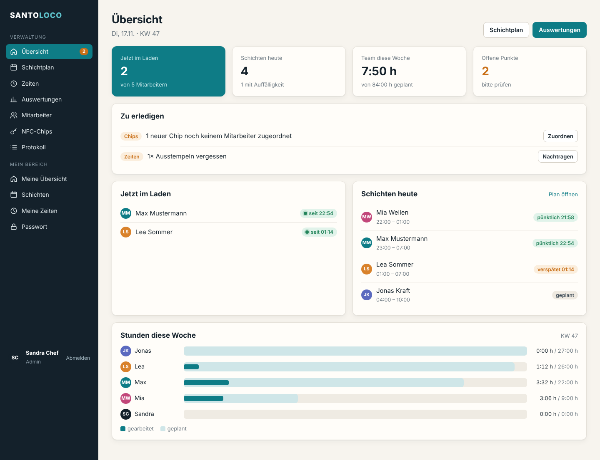

# SantoLoco Zeiterfassung

Web-App für Schichtplanung und Zeiterfassung mit NFC-Chips. Läuft auf jedem normalen Webhoster mit PHP und MySQL. Es gibt keine weiteren Abhängigkeiten.



Weitere Ansichten: [Schichtplan](docs/screenshots/2_schichtplan.png) · [Auswertungen](docs/screenshots/3_auswertungen.png) · [Mitarbeiter](docs/screenshots/4_mitarbeiter_uebersicht.png) · [Handy](docs/screenshots/5_handy.png)

## Was die App kann

**Admin (Chef)**
- Übersicht: Wer ist gerade im Laden, Schichten heute mit Pünktlichkeit, Stunden der Woche, offene Punkte
- Schichtplan: Wochenansicht, Schichten anlegen, bearbeiten und löschen, Vorwoche übernehmen, Überschneidungen werden erkannt
- Zeiten: alle Buchungen ansehen, nachtragen, korrigieren, stornieren und Hinweise abhaken
- Auswertungen pro Monat: gearbeitet und geplant, Plus/Minus, Verspätungen, Fehltage, fehlende Stempel, Verlauf nach Wochen, CSV-Export
- Mitarbeiter: Konten anlegen, Soll-Stunden und Rolle festlegen, Passwort zurücksetzen, deaktivieren
- NFC-Chips: neu erkannte Chips mit einem Klick zuordnen, sperren, beschriften
- Protokoll: Jede Änderung wird mit Zeit und Person festgehalten.

**Mitarbeiter**
- Übersicht: Status (eingestempelt seit …), nächste Schicht, Stunden der Woche und des Monats, Pünktlichkeit, Wochen-Diagramm
- Schichten: eigene nächste 4 Wochen und der Team-Plan (nur lesen)
- Meine Zeiten: alle Arbeitszeiten pro Monat, CSV-Export
- Passwort ändern

## Installation beim Webhoster

1. **Dateien hochladen**, z. B. per SFTP in einen Ordner `zeiterfassung/`.
2. **Webroot setzen:** In der Hosting-Verwaltung die Domain bzw. Subdomain (z. B. `zeit.santoloco.de`) auf den Ordner **`public/`** zeigen lassen. Geht das nicht, schützen die mitgelieferten `.htaccess`-Dateien die internen Ordner.
3. **Datenbank anlegen:** eine MySQL/MariaDB-Datenbank in der Hosting-Verwaltung erstellen.
4. **Konfiguration:** `config.sample.php` nach `config.php` kopieren und anpassen:
   - Datenbankzugang (MySQL-Zeilen einkommentieren, SQLite-Zeilen entfernen)
   - einen langen Zufallsschlüssel für das Terminal eintragen
5. **Einrichten:** Im Browser `https://zeit.santoloco.de/install.php` öffnen und das erste Admin-Konto anlegen.
6. **`public/install.php` löschen.**
7. **HTTPS:** Ein SSL-Zertifikat muss aktiv sein. Bei den meisten Hostern ist es kostenlos per Let's Encrypt.

Voraussetzungen: PHP 8.1 oder neuer mit `pdo_mysql`, MySQL 5.7+ oder MariaDB 10.3+.

## Lokal ausprobieren

**1. PHP installieren** (einmalig, Version 8.1 oder neuer)

- **Mac:** mit [Homebrew](https://brew.sh) `brew install php`
- **Windows:** [Laragon](https://laragon.org) oder [XAMPP](https://www.apachefriends.org) installieren, oder PHP von [windows.php.net](https://windows.php.net/download/) entpacken und den Ordner zum `PATH` hinzufügen. In der `php.ini` müssen `extension=pdo_sqlite`, `extension=sqlite3` und `extension=mbstring` aktiv sein.
- **Linux:** `sudo apt install php-cli php-sqlite3 php-mbstring`

Prüfen mit `php -v`.

**2. Starten** (im Projektordner)

```bash
cp config.sample.php config.php       # Windows: copy config.sample.php config.php
php bin/demo.php                       # Beispieldaten anlegen
php -S localhost:8000 -t public
```

Dann `http://localhost:8000` im Browser öffnen. Lokal wird SQLite verwendet, eine Datenbank muss nicht installiert werden. Mit `php bin/demo.php --reset` setzt du die Demo zurück.

| Rolle | Anmeldung |
|---|---|
| Admin | `chef@santoloco.test` / `demo-passwort` |
| Mitarbeiter | `max@santoloco.test` / `demo-passwort` |

## Schnittstelle für das Stempelterminal (ESP32)

```
POST https://zeit.santoloco.de/api.php
Header:  X-Terminal-Key: <Schlüssel aus config.php>
Body:    {"uid": "04A31F7C"}                      automatisch Kommen/Gehen
         {"uid": "04A31F7C", "action": "kommen"}  fest, z. B. mit Kippschalter
```

Antwort (JSON), zum Anzeigen auf dem Display:

| status | Bedeutung | Anzeige-Vorschlag |
|---|---|---|
| `booked` | gebucht, `action` = kommen/gehen | grün: „Max – Eingestempelt 08:57“ |
| `ignored` | zweimal angetippt, nichts gebucht | blau: „Bereits eingestempelt“ |
| `unknown` | neuer Chip, wurde im Admin-Bereich angelegt | gelb: „Neuer Chip – bitte zuordnen“ |
| `unassigned` | Chip bekannt, aber niemandem zugeordnet | gelb |
| `blocked` / `inactive` | Chip gesperrt oder Konto deaktiviert | rot |
| `unauthorized` | falscher Terminal-Schlüssel (HTTP 401) | rot: „Terminal nicht berechtigt“ |

`GET /api.php` mit demselben Header liefert die Serverzeit. Damit kann das Terminal die Verbindung prüfen.

Testen ohne Terminal:

```bash
curl -H "X-Terminal-Key: DEIN-SCHLUESSEL" -d uid=04A31F7C https://zeit.santoloco.de/api.php
```

Beispiel für den ESP32 (Arduino, Bibliotheken `WiFiClientSecure`, `HTTPClient`, `ArduinoJson`):

```cpp
WiFiClientSecure client;
client.setCACert(ROOT_CA);            // Zertifikat der Domain hinterlegen
HTTPClient http;
http.begin(client, "https://zeit.santoloco.de/api.php");
http.addHeader("Content-Type", "application/json");
http.addHeader("X-Terminal-Key", TERMINAL_KEY);
int code = http.POST("{\"uid\":\"" + uidHex + "\"}");
JsonDocument doc;
deserializeJson(doc, http.getString());
showOnDisplay(doc["status"], doc["name"], doc["message"], doc["time"]);
http.end();
```

## Regeln beim Stempeln

- **Automatischer Wechsel:** Ist jemand eingestempelt, wird als Nächstes „Gehen“ gebucht, sonst „Kommen“.
- **Doppeltes Antippen:** Innerhalb von 2 Minuten wird es ignoriert (`cooldown_seconds`).
- **Ausstempeln vergessen:** Ist ein Kommen älter als 14 Stunden (`forgotten_hours`), zählt das nächste Antippen als neues „Kommen“. Die alte Buchung wird für den Admin als „Ausstempeln vergessen“ markiert.
- **Verspätung:** Ein Kommen später als 5 Minuten nach Schichtbeginn gilt als verspätet (`late_grace_minutes`).
- **Uhrzeit:** Sie kommt immer vom Server, nicht vom Terminal.

## Sicherheit

- Passwörter werden nur als Hash gespeichert (`password_hash`).
- Nach 5 Fehlversuchen ist das Konto 15 Minuten gesperrt.
- Alle Formulare sind gegen Fremdaufrufe geschützt (CSRF-Token).
- Datenbankabfragen sind gegen SQL-Injection gesichert (Prepared Statements).
- Das Terminal braucht einen geheimen Schlüssel. Ohne ihn nimmt der Server keine Buchung an.
- Jede Änderung an Zeiten, Schichten, Chips und Konten steht im Protokoll.
- Es gibt keine Ortung und keine Daten auf privaten Handys.

## Ordner

```
public/     Webroot: index.php (Seiten), api.php (Terminal), install.php, assets/
src/        Logik: Datenbank, Anmeldung, Zeitberechnung
pages/      Steuerung der einzelnen Seiten
views/      HTML-Vorlagen
bin/        setup.php (Einrichtung per Konsole), demo.php (Beispieldaten)
data/       SQLite-Datei (nur beim lokalen Test)
```
